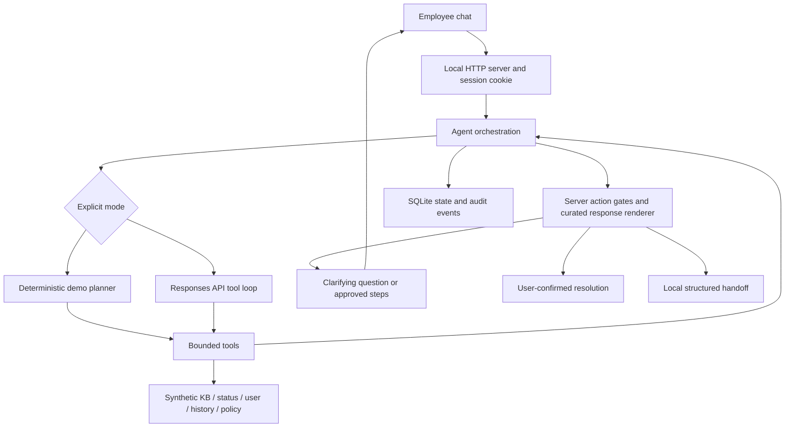

# IT Companion — Employee IT Support Agent

A locally runnable take-home project focused on **VPN disconnects and internal application access**, with bounded account sign-in triage and explicit escalation for permission requests. The employee is the user; there is no ticket form to fill out before receiving help.

The UI is Chinese-first and accepts Chinese/English input. All company records, service incidents, clients and runbooks are **synthetic**. This is a take-home prototype, not affiliated with a real IT system and not clinical or manufacturing software.

Submission material index: [SUBMISSION.md](SUBMISSION.md).

## Quick start — no API key required

Requires **Python 3.9+**. Demo and API Key modes use the standard library. ChatGPT OAuth additionally requires `requirements-chatgpt.txt` for JWT signature validation. No Node.js or database service is required.

```sh
cd it-support-agent
python3 -m app.server
```

Open **http://127.0.0.1:8765**. This explicitly labeled **rule demo mode** uses the same tools, persistence, policy gates, handoff and UI as the model mode. Its language understanding is deliberately limited. It is not presented as a real LLM agent.

If the port is occupied:

```sh
python3 -m app.server --port 8766
```

Stop with Ctrl+C. Local state is stored in `runtime/support.sqlite3`, excluded from Git. For a disposable demonstration database, pass `--db /path/to/scratch.sqlite3`. The session cookie restores the active session after refresh/restart, provided the same hostname, cookie and database are retained. A new session replaces the active browser session, while prior records remain in the local database. Tabs sharing that cookie share a session.

## Real model mode — API Key (retained)

The real agent uses the **OpenAI Responses API function-calling loop**. Configure a model that supports Responses and function calling and is enabled for your account:

```sh
export OPENAI_MODEL='your-enabled-model-id'
read -s OPENAI_API_KEY
export OPENAI_API_KEY
python3 -m app.server --mode openai
```

After the `read` command, paste the key and press Enter; input is hidden. The key stays in the server environment and is never sent to the browser. `.env.example` lists settings; `.env` is intentionally **not auto-loaded**. Do not put credentials in Git, screenshots, chat or a recording.

In model mode, redacted conversation text, simulated employee data and relevant tool results are sent to OpenAI. `store:false` disables Responses application storage; this does not assert zero provider retention. Read the provider's current data policy before using real company data. The prototype must only be used with synthetic inputs.

**Verification status:** API Key credentials were not configured, so real API Key billing-path calls remain unverified. The added ChatGPT OAuth path has completed real authorization, model catalog retrieval and a small real-model suite of new paraphrases and edge cases. See `docs/新增真实模型测试报告-2026-10-22.md` for the first-run failures, fixes and targeted retests. This is not an independent external benchmark or production accuracy score. Model errors generate an explicit local handoff; the app never silently switches to demo mode.

API implementation reference: [Official OpenAI function calling documentation](https://developers.openai.com/api/docs/guides/function-calling).

## ChatGPT subscription authorization (additional connection)

The original API Key provider and environment variables remain available. The UI offers three explicit connection choices: ChatGPT authorization, OpenAI API Key, and deterministic demo. Changing connections creates a new conversation; no error silently falls back to another billing path.

```sh
python3 -m venv .venv
.venv/bin/python -m pip install -r requirements-chatgpt.txt
.venv/bin/python -m app.server --mode chatgpt
```

Open **http://127.0.0.1:8765/?connection=chatgpt** in Chrome or Safari. Select **Continue with ChatGPT**, complete OpenAI sign-in and grant the requested plan permission yourself. For a local personal project, this follows the official dynamic-client registration flow; availability remains subject to account/workspace policy. On return, the app fetches the selected account's model catalog. Pick a model and select “使用这个连接，开始新会话”. Login for model billing does not establish the simulated employee's corporate identity.

The in-app browser reached the OpenAI login form but its Continue button did not advance in the observed attempt; the user reported that an ordinary browser proceeded. If this happens, start again from the local app in Chrome/Safari. Do not copy only the external login page, because the fresh authorization transaction and callback binding are created in the local app's browser. OAuth attempts expire after 10 minutes. Do not restart the server during an active attempt; pending state is memory-only.

Test query after authorizing, choosing a model and starting a **fresh** conversation with e001 / 服务正常:

> 我在家远程办公，用公司 Windows 电脑，VPN 每隔十几分钟断一次，今天上午开始。请查一下我的 VPN 权限、服务状态、相关排查资料和类似案例，再给我一个允许执行的排查方法。

Expected observation: the model request count increases and 排查记录 shows actual function calls marked **模型调用**, including some combination of `get_profile`, `check_status`, `search_kb`, `search_history`, `check_policy`, followed by `finish`. A reasonable clarifying question may precede tools; answer it rather than assuming a failure. Tool execution still uses the synthetic backend.

ChatGPT credentials are stored only in `runtime/oauth/chatgpt-accounts.json` (directory 0700, atomic file 0600), excluded from Git and the source ZIP. This app never reuses Codex/browser credentials. Accounts are separated by validated issuer/client/subject, and the UI supports adding or reauthorizing registrations. State, nonce, PKCE, exact callback, issuer, RS256 signature, issued-client audience, expiration and subject are validated. Granted token scopes determine plan availability. Refresh uses the issued client ID and rotates credentials together. Disconnect attempts remote session revocation, then clears this app's local tokens and reports if remote revocation was not confirmed. The local file is permission-protected, not encrypted.

ChatGPT model requests use the public `/v1/responses` endpoint, `store:false`, `stream:true`, namespaced function tools, and omit unsupported output-limit parameters. The parser waits for `response.completed` before executing tools. Incomplete streams, quota errors and eligibility failures stop the request; the API Key connection is never automatically charged as a fallback. The existing API Key provider keeps its own request contract and settings.

Official references: [Registration/sign-in](https://developers.openai.com/siwc/token-sharing-open-source/sign-in), [Models/inference](https://developers.openai.com/siwc/token-sharing-open-source/models-and-inference), [Preview request limitations](https://developers.openai.com/siwc/token-sharing-open-source/preview-limitations).

**Live verification:** OpenAI authorization, granted plan scopes, JWT validation, restart persistence and retrieval of 7 available models completed. One synthetic VPN conversation using `gpt-6.1-sol` completed in 15.75 seconds with 4 model requests and 7 model-selected tool calls: `set_context`, `get_profile`, `check_status`, `search_kb`, `search_history`, `check_policy`, `finish`. The resulting guide was backed by the approved runbook. See `evaluation/chatgpt-smoke.json` (no account credentials or personal identity data). That was the initial smoke check. The subsequent 13-case suite, initial 11/13 result and targeted retests are documented in `docs/新增真实模型测试报告-2026-10-22.md`.

## Problem and scope

Employees often cannot distinguish a local VPN issue, service outage, identity problem or missing entitlement. A static FAQ can provide a generic article but cannot gather missing facts, reconcile service status with user context, remember attempted steps and preserve a diagnostic handoff across turns.

The intended successful interaction is: describe symptoms, clarify missing information, inspect relevant sources, attempt a documented reversible check and confirm recovery. The prototype measures decisions and evidence; it does not claim a measured two-minute resolution target. The VPN network-isolation runbook intentionally needs a 15-minute observation.

In scope:

- Remote VPN disconnects: isolate home network from client/service issues using an approved hotspot check.
- VPN connected but internal applications unavailable: safe reconnect and feedback.
- Read-only account sign-in triage: report error category, never collect credentials.
- Permission requests, locked accounts, unsafe requests and unsupported systems: preserve context for a human.

Out of scope: actual device control, account resets, access grants, SSO integration, ServiceNow dispatch, broad infrastructure root-cause analysis and medical/regulated workflows. A pipeline/Jenkins/Tableau incident is escalated with context. Supporting every sample in the brief is deliberately traded for a reliable narrow workflow.

## Architecture



`app/agent.py` owns state transitions and authorization. The model selects queries, records reported facts, interprets returned evidence and proposes a next action. `finish` is a structured decision tool, not unrestricted user-facing prose. The server renders approved questions, verified runbook steps or an escalation category. This prevents an invented command from reaching the user through a fluent model answer. It also sacrifices conversational flexibility; that is an explicit design tradeoff.

The model is bounded to 8 logical requests and 10 function calls per turn. It may batch independent read-only tools. A 55-second soft turn budget is checked before each logical request. API Key HTTP calls use a 20-second socket timeout. ChatGPT calls use 25 seconds and may retry one transport failure after a 0.5-second delay. HTTP/quota/permission errors and incomplete response events do not take that retry path. `transport_retries` is recorded separately from logical `model_calls`; retrying may consume additional plan quota. These are not a hard wall-clock SLA. The server caps employee messages at 2,000 characters and sessions at 20 turns.

### Tools and simulated data

| Source / tool | Purpose | Example |
|---|---|---|
| `get_profile` | Session-bound employee equipment and VPN entitlement | Assigned Windows/macOS device, office, access groups |
| `check_status` | Health, observation time and recent changes | Global VPN incident, certificate rotation |
| `search_kb` | Small issue-filtered approved runbook search | Remote disconnect / connected without access |
| `search_history` | Similar cases as supporting hypotheses | Hotspot isolation in a prior case; explicitly not causal proof |
| `check_policy` | Allow / approval-required / deny | Reconnect allowed; access grant requires approval |
| `set_context` | Record employee-reported issue, current location and symptom | Office in profile is never treated as current location |
| `finish` | Propose ask / guide / resolved / escalate | All guidance validated before display |

Data is in `data/fixtures.json`: three synthetic employees, three approved runbooks, a retired unsafe article excluded from retrieval, two service records, three historical cases and structured action rules. Retrieval is lexical/issue-based rather than vector search; this is appropriate for three articles, not evidence of production retrieval quality.

The lab uses a **fixed 2026-04-21 snapshot clock**, shown in the UI and tool results. Health freshness is tested relative to that clock (TTL 600 seconds), never against the computer's current time. The snapshot is a reproducible simulation, not live health. Production adapters must use real observation times and revalidate before actions.

### State and memory

Phases: `clarifying → awaiting_feedback → resolved / escalated`. There is no automatic resolution after providing instructions. The latest user message must explicitly confirm recovery, and at least one approved step must have been offered. Negated success is not accepted. Unrecognized success phrasing is conservatively escalated in demo mode; that is a known recall limitation.

State includes reported facts, tool evidence, prior steps/outcomes, messages, response citations, metrics and the model protocol history. SQLite saves after each completed turn. A changed issue clears diagnostic evidence and attempts so that a VPN article cannot authorize an unrelated access request. Audit history is retained. Terminal handoffs are idempotent; continuing with a different issue requires a new session.

### Resolution vs. escalation

A proposed guide is blocked unless the system has:

1. Current reported location and symptom, plus a session-bound employee profile.
2. A fresh operational service record and the required VPN entitlement where applicable.
3. A retrieved, active, reviewed runbook matching the issue, device and remote/office scope.
4. No unresolved conflicting actions among current runbooks.
5. An explicit `allowed` policy check and an unused runbook within the attempt limit.

Known outage, stale/failed status, missing article, conflicting advice, missing entitlement, repeated failed guidance, unsupported problem, model failure or employee request → local handoff. Permissions and account unlocks require human verification/approval. No write tools exist.

The handoff contains employee identity, reported problem, urgency signal, evidence IDs, tool results/errors, steps and feedback, transcript and remaining uncertainties. **It is a downloadable local JSON artifact, not an externally filed ticket.** The employee does not re-enter facts. Dispatch and actual human response require integration work.

## Evaluate

```sh
python3 -m unittest discover -s tests -v
python3 evaluate.py
```

The included build report is `evaluation/demo-report.json`. At the recorded run: **44 unit/integration tests passed; 19/19 deterministic scenarios passed**. The report includes individual expected/actual decisions, traces and metrics. Tests cover HTTP origin/host enforcement, session isolation, persistence, bad tool arguments, unapproved actions, false closure, handoff context, model-loop bounds and Responses protocol continuity with fake transport.

Scenarios include multi-turn resolution, failed recovery, vague input, outage, stale status, timeout, missing knowledge, absent entitlement, production access, account lock, conflicting runbooks, malicious retrieved instructions, English input and unsupported systems.

Run real model scenarios **after configuring credentials**:

```sh
python3 evaluate.py --live
```

This sends synthetic cases to the API, consumes tokens and writes `evaluation/live-report.json`. It uses the same labeled expectations; review traces when the model asks an additional reasonable question. Exact sequence matching is deliberately strict and is not a complete semantic quality metric. Review the trace and latency rather than interpreting exact decision matching as a complete model quality score. The separate ChatGPT evaluation below includes newly authored paraphrases and failure cases.

### Additional real ChatGPT checks

```sh
.venv/bin/python evaluate_extended.py --report evaluation/my-extended-run.json
.venv/bin/python evaluate_extended.py --only natural_recovery_confirmation english_paraphrase --report evaluation/my-retest.json
```

This uses the active local app and its selected ChatGPT connection, creates isolated sessions, and consumes subscription quota. The labeled inputs are in `evaluation/extended-cases.json`. It checks unfamiliar Chinese/English expressions, clarification, natural recovery feedback, topic changes, waiting for user action, negative recovery reports, missing permissions, stale/missing/conflicting evidence, tool timeout and retrieved prompt injection. An actual model error prevents a successful-path check from passing merely because the app safely escalated.

Initial live result: **11/13**. A context/confirmation bug was fixed; a connection failure on the English case recurred in its first retest and was retained in the reports. After targeted retests, the latest observed result for each case is **13/13**; this is **not** a final-build full-suite 13/13 run. The final live English retest did not trigger the newly added bounded retry; retry behavior was tested with synthetic connection failures. [Detailed Chinese report](docs/新增真实模型测试报告-2026-10-22.md), [summary JSON](evaluation/extended-summary-2026-10-22.json).

Limitations of current evaluation: fixtures and scenarios were co-designed, there is one regression run, and the scenarios are not an independent holdout. Presence of a tool does not prove the model used it well. The injection regression verifies known attacks and renderer boundaries, not exhaustive security. Production evaluation should add independently written conversations, expert-rated diagnoses, escalation precision/recall, answer grounding and real user task success.

## Reliability, safety and production thinking

- The identity tool accepts no employee ID. The selected identity is bound at session creation. Demo identity selection is not authentication.
- Tools are allowlisted, read-only, argument-checked and return structured results. Unknown actions default to deny.
- Retrieved documents are untrusted data. Only content identical to the approved static runbook registry can become troubleshooting steps. Legacy disabling-protection advice is retired.
- Model-generated escalation prose is not rendered; it chooses a reason category. Confidence labels describe evidence, not invented probabilities or hidden model reasoning.
- Basic secret-pattern redaction runs before persistence/model input. It is not complete DLP; do not enter real secrets. Local SQLite is unencrypted and has no expiry policy.
- The server binds loopback only, checks Host and mutation Origin, uses an HttpOnly SameSite cookie, fixed static-file routes and a restrictive CSP. This is not production authentication or hardened internet hosting.
- Trace events record tool name, arguments, result, timestamp, turn and latency; metrics record attempted model calls, returned input/output tokens and user-visible turn duration. Provider failures omit response bodies and credentials. No hidden chain of thought is shown.
- Cost is monitored through logical request, retry and token metrics. The API Key provider caps response tokens; the ChatGPT plan route does not accept that parameter and relies on call/time limits and account settings. Calculate cost using the selected model's current pricing. Entire model history grows across up to 20 turns; production needs bounded summaries and context budgets.
- Maintainability: one orchestrator, small tool adapters, independent provider transport and deterministic tests. The standard library reduces setup burden. The coarse server lock serializes all chats in this local prototype; it is not suitable for multi-user production concurrency.

With more time: expand real-model evaluation beyond the small synthetic suite, add independently authored held-out evaluation, stronger multilingual intent/confirmation handling, structured contradiction detection (including conflicts within the same action), proper per-session concurrency and cancellation, OIDC/SSO, RBAC-scoped retrieval, authenticated live service adapters, encrypted retention controls, audit export, a durable handoff outbox and ServiceNow delivery acknowledgement. More complex write actions would need deterministic approval/identity gates and idempotency before being exposed as tools.

## Repository map

```text
app/agent.py       orchestration, state, gates, curated replies
app/provider.py    API Key + ChatGPT SSE providers; function schemas
app/chatgpt_auth.py OAuth registration, JWT validation, refresh, local credentials
app/tools.py       synthetic read-only adapters
app/store.py       SQLite persistence
app/server.py      loopback HTTP API and static UI
web/              Chinese-first chat, source traces, handoff download
data/fixtures.json synthetic data and authorization rules
tests/            unit and HTTP integration tests
evaluation/       labeled conversations and recorded regression report
docs/             Chinese walkthrough, demo script, design decisions, AI disclosure
```

Read `docs/面试讲解与演示.md` for the candidate walkthrough and `docs/AI_USAGE.md` for work attribution and the scope of candidate participation. Independent candidate code review is not asserted.
